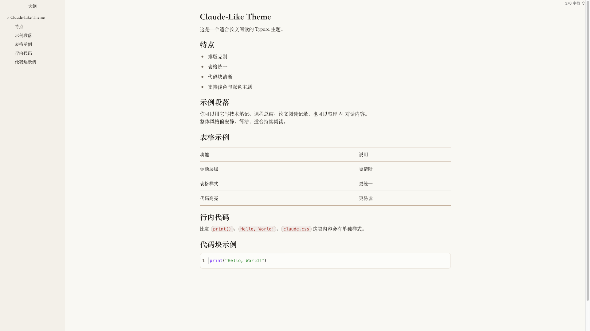
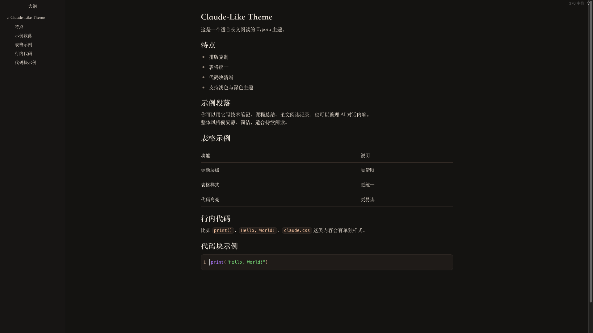

# Claudy Theme

一个以 Claude 的阅读体验为灵感、为中文长文写作深度打磨的 Typora 主题：霞鹜文楷正文 × 梦源黑体标题，暖纸色浅色与暖炭色深色双主题，功能色通过 WCAG AA 对比度校验，根字号随窗口自适应。纯 CSS、无构建、双主题同步维护。

> [English Version Below](#english-version)

## 安装方式

也可以直接从 GitHub 的 Releases 页面下载最新主题文件。

1. 打开 Typora。
2. 进入 `设置 / 偏好设置 -> 外观 -> 打开主题文件夹`。
3. 将以下文件复制到主题目录中：

   - `claudy.css`
   - `claudy-dark.css`
4. 重启 Typora。
5. 在主题菜单中选择：

   - `Claudy`
   - `Claudy Dark`

> **推荐设置（Windows）**：进入 `偏好设置 -> 外观`，将**窗口样式**设为**一体化**（重启 Typora 后生效），主题在 Windows 一体化模式下显示效果最佳。

它不是简单地把网页样式搬进 Typora，而是保留了 Claude 那种安静、克制、长文友好的阅读气质，同时针对中文内容、表格、代码块、导出效果做了重新调校。

## 设计目标

- 让长文阅读更稳定，不抢内容本身的注意力。
- 让中文标题、正文、强调文本之间的层级更清楚。
- 让技术文档里最常见的表格、代码块、行内代码保持统一风格。
- 同时提供浅色、深色两个版本，减少切换场景时的割裂感。

## 主题特点

### 1. 低疲劳的阅读配色

- 浅色：暖纸色底（`#faf9f5`）搭配深暖灰正文，安静的纸张质感
- 深色：暖炭色底（非纯黑）搭配暖白文字（非纯白），亮度压在低疲劳区间，暗环境长时间写作不刺眼
- 链接、代码、标签等功能色逐项按 WCAG AA（≥ 4.5:1）实调校验

低饱和暖色系、轻对比、宽松留白，适合技术笔记、课程总结、论文阅读记录、AI 对话整理与中英混排文档。

### 2. 为中文定制的字体系统

- 正文：霞鹜文楷（LXGW WenKai），楷调手写感，适合长文沉浸阅读
- 标题：梦源黑体 CN（基于思源黑体，提供 27 档真实字重），「楷体正文 × 黑体标题」层级一目了然，标题字重全部命中真实档位、无合成加粗
- 代码：Maple Mono NF CN 等宽字体，自带中文字形，中西文严格 2:1 对齐
- 完整回退链覆盖 Windows / macOS，未安装推荐字体时自动落到系统字体，效果依然可预测

### 3. 随窗口自适应的排版

- 根字号通过 CSS `clamp()` 随窗口宽度在 16–18px 平滑缩放，笔记本到 4K 一套代码适配
- 版心与侧栏全部使用相对单位，缩放等比跟随
- 正文 17px、行高 1.75、段距 0.95em，按中文长文节奏调校
- 侧栏字号、字重、行距独立调校，长文件名自动换行

### 4. 克制而完整的组件设计

- 引用：细边线式，融入正文流
- 行内代码：轻底色 + 微圆角，连续出现不打断阅读
- 代码块：独立底色与边框，低彩度语法高亮与主题暖色系统一，不似 IDE 配色跳脱
- 表格：横线体系，长短内容都不撑破版面
- 目录：独立边框容器，与引用明确区分
- 补齐 `mark` 高亮、`kbd` 按键与脚注样式
- 源码模式配色与代码块逻辑在双主题下完全同构

### 5. 两套主题同步维护

项目包含：

- `claudy.css`：浅色
- `claudy-dark.css`：深色

两套主题按各自底色独立调校对比度、边框强度与高亮色，但版心、字体与组件逻辑完全同构，切换时没有阅读断层。

## 适用场景

这套主题尤其适合下面几类内容：

- 需要持续阅读的长篇 Markdown 文档
- AI 对话整理与二次编辑
- 面向中文读者的技术讲义
- 带有大量表格和代码块的说明文档
- 希望导出 PDF 时仍保持稳定版式的内容

如果你更偏好高装饰、强品牌感、或者非常夸张的标题视觉，这套主题可能不是最激进的选择；但如果你希望文档“看起来像认真整理过”，它会更合适。

## 文件说明

- `claudy.css`：浅色主题
- `claudy-dark.css`：深色主题

## 已优化的细节

- 中文正文排版节奏（字号 / 行高 / 段距）
- 黑体标题的真实字重层级
- 功能色对比度（WCAG AA）
- 深色主题亮度与光晕控制
- 行内代码轻量化样式
- 代码块低彩度语法高亮
- 表格边框与间距统一
- 侧栏可读性与长文件名自动换行
- 根字号随窗口自适应
- Typora 编辑界面与导出风格一致性

## 后续可继续扩展的方向

- 补充更多导出场景截图
- 为引用块、数学公式、任务列表继续细化细节
- 增加更偏论文风格或更偏博客风格的变体

## 总结

Claudy Theme 的核心不是“看起来像某个网页”，而是把那种安静、可信、适合长时间阅读的气质带进 Typora，并把它真正做成一套适合中文 Markdown 写作的主题。

如果你的文档里经常同时出现标题、表格、代码块和长段说明文本，这套主题会比较适合你。

## 协议

本项目基于 MIT 协议开源，详见根目录 [LICENSE](LICENSE) 文件。

## 商标说明

Claude 是 Anthropic, PBC 的商标。本项目与 Anthropic 无任何关联，也未获其官方授权或认可。主题名称「Claudy」源于 Claude 的视觉气质，仅指风格上的灵感来源，不代表任何官方产品或品牌关系。

---

``

# Claudy Theme

A Typora theme inspired by Claude's reading experience, deeply refined for Chinese long-form writing: an LXGW WenKai body with Dream Han Sans headings, warm-paper light and warm-charcoal dark variants, WCAG AA feature colors, and window-adaptive typography. Pure CSS, no build step, both themes maintained in sync.

## Installation

You can also download the latest theme files directly from the GitHub Releases page.

1. Open Typora.
2. Go to `Preferences -> Appearance -> Open Theme Folder`.
3. Copy the following files into the theme folder:

   - `claudy.css`
   - `claudy-dark.css`
4. Restart Typora.
5. Choose one of the following from the Theme menu:

   - `Claudy`
   - `Claudy Dark`

> **Recommended setting (Windows)**: Go to `Preferences -> Appearance` and set **Window Style** to **Unibody** (restart Typora to apply). The theme is optimized for Unibody mode on Windows.

It is not a direct clone of a webpage. Instead, it keeps the calm, restrained, long-form reading atmosphere associated with Claude's style, while reworking typography, tables, code blocks, and export behavior for practical Markdown use.

## Design Goals

- Make long-form reading feel stable and low-noise.
- Improve hierarchy between headings, body text, and emphasis in Chinese documents.
- Keep tables, fenced code blocks, and inline code visually consistent.
- Maintain a coherent experience across light and dark modes.

## Highlights

### 1. A low-fatigue reading palette

- Light: warm paper background (`#faf9f5`) with deep warm-gray text — a quiet paper feel
- Dark: warm-charcoal background (never pure black) with warm-white text (never pure white), held in a low-fatigue brightness range for long dark-mode sessions
- Every functional color (links, code, tags) is individually verified against WCAG AA (≥ 4.5:1)

Low-saturation warm tones, soft contrast, and generous spacing make it a good home for technical notes, course summaries, paper-reading notes, AI conversation archives, and mixed Chinese-English documents.

### 2. A type system built for Chinese

- Body: LXGW WenKai (霞鹜文楷), a handwriting-flavored kai face made for immersive long-form reading
- Headings: Dream Han Sans CN (梦源黑体), a Source Han Sans based family with 27 real weights — kai body × sans headings keeps hierarchy obvious, and heading weights always hit real font weights with no synthetic bolding
- Code: Maple Mono NF CN, a monospace with built-in CJK glyphs and strict 2:1 Latin-CJK alignment
- Complete fallback chains for Windows / macOS: without the recommended fonts installed, the theme degrades gracefully to system fonts

### 3. Window-adaptive typography

- The root font size scales smoothly from 16–18px with window width via CSS `clamp()` — one code path from laptops to 4K displays
- Content width and the sidebar use fully relative units and scale in lockstep
- Body 17px / line-height 1.75 / paragraph spacing 0.95em, tuned for Chinese long-form rhythm
- The sidebar has its own size, weight, and line-height tuning, with long file names wrapping automatically

### 4. Restrained but complete components

- Blockquotes: a slim border-line style that stays inside the text flow
- Inline code: light background with a small radius, never choppy in runs
- Code blocks: their own background and border, with low-saturation syntax colors unified with the warm palette (no IDE neon)
- Tables: a horizontal-rule system that survives short cells and long overflowing strings alike
- TOC: its own bordered container, clearly distinct from quotes
- Missing pieces filled in: `mark` highlights, `kbd` keys, and footnotes
- Source-mode colors mirror the fenced-code logic in both themes

### 5. Two themes maintained together

The project includes:

- `claudy.css` — light
- `claudy-dark.css` — dark

Each variant is tuned independently for its own background — contrast, border strength, and highlight colors — while sharing identical layout, typography, and component logic, so switching between them never breaks reading rhythm.

## Best Use Cases

This theme is especially suitable for:

- long Markdown documents
- AI conversation cleanup and editing
- Chinese technical notes
- documents with many tables and code blocks
- content that still needs to look stable after PDF export

If you prefer highly decorative layouts or very dramatic heading styles, this theme is probably not the most aggressive choice. But if you want your document to feel clean, deliberate, and trustworthy, it is a good fit.

## Files

- `claudy.css`: light theme
- `claudy-dark.css`: dark theme

## Refined Details

- Chinese body rhythm (size / line height / paragraph spacing)
- real-weight sans heading hierarchy
- WCAG AA functional colors
- dark-theme brightness and halation control
- lightweight inline code styling
- low-saturation syntax highlighting
- unified table rhythm and borders
- sidebar readability with automatic file-name wrapping
- root font size adapting to window width
- consistency between Typora editing and export

## Possible Future Extensions

- more export screenshots
- further refinement for blockquotes, math, and task lists
- additional variants for academic or blog-oriented writing

## Summary

Claudy Theme is not about mechanically imitating a webpage. Its goal is to bring a calm, credible, long-reading-friendly atmosphere into Typora and turn that into a theme that actually works for Chinese Markdown writing.

If your documents often mix headings, long explanations, tables, and code blocks, this theme should fit that workflow well.

## License

This project is licensed under the MIT License. See [LICENSE](LICENSE) for details.

Claude is a trademark of Anthropic, PBC. This project is not affiliated with, endorsed by, or sponsored by Anthropic.

## Trademark Notice

Claude is a trademark of Anthropic, PBC. This project is not affiliated with, endorsed by, or sponsored by Anthropic. The name "Claudy" derives from the visual atmosphere of Claude that inspired this theme, not from any official product or brand affiliation.

## Star History

